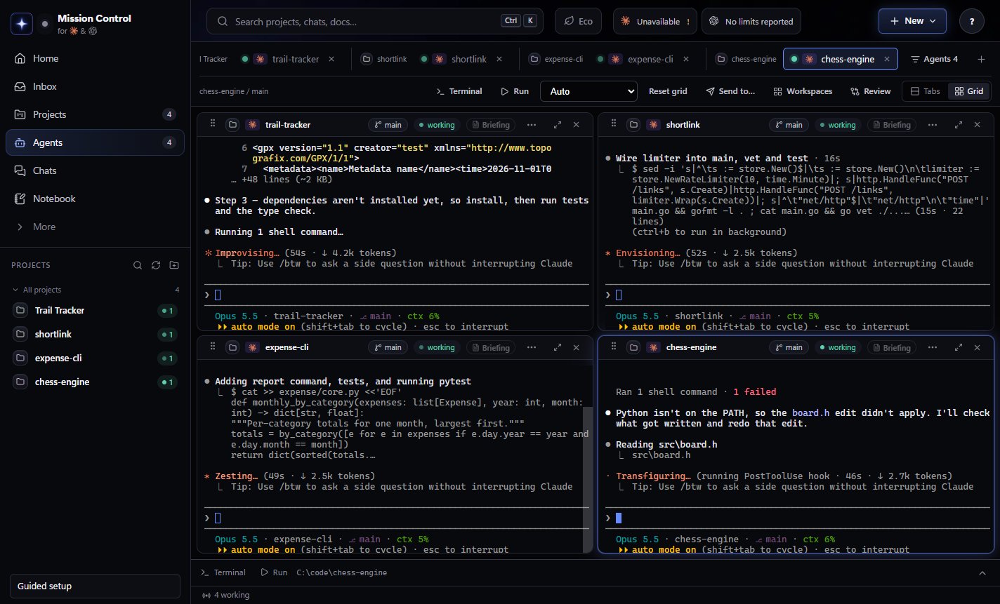
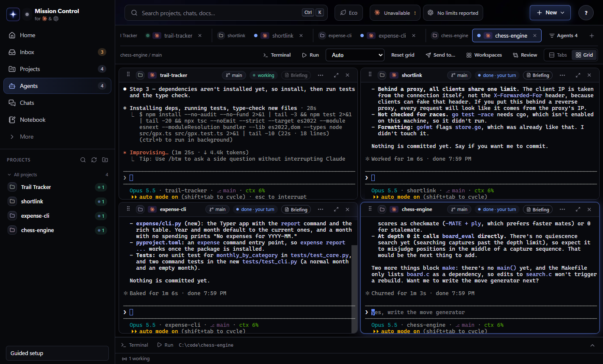
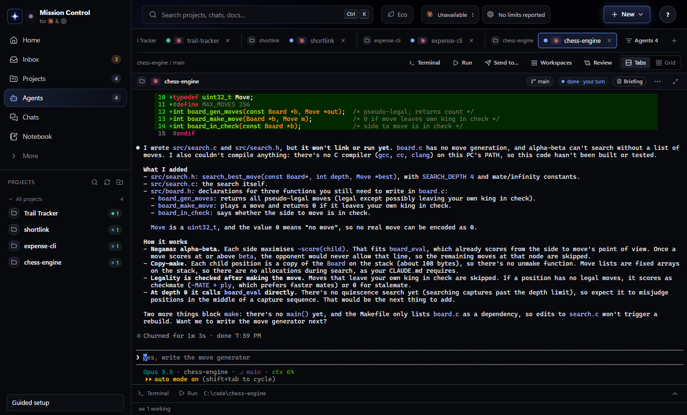
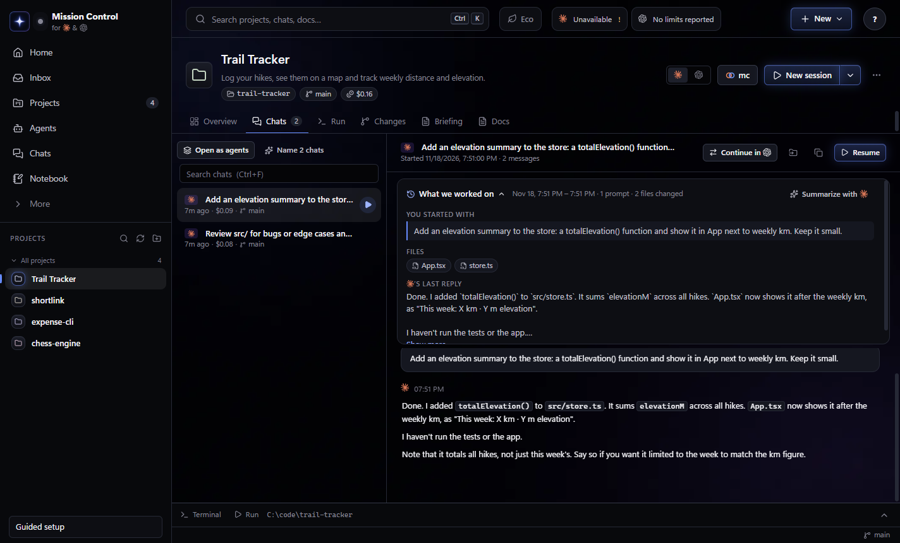
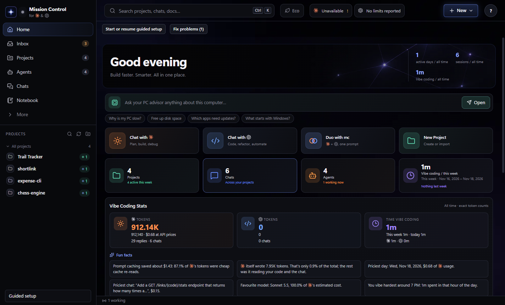
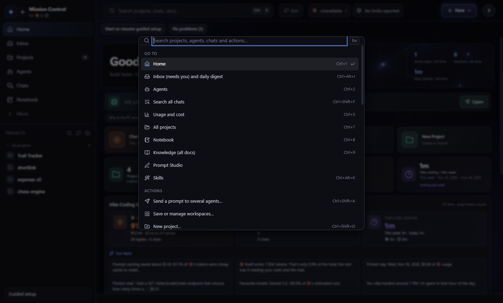

<h1 align="center">Mission Control</h1>

  <b>Run several Claude Code and Codex agents side by side on Windows, and see everything they do in one window.</b> 
  Projects, live agent terminals, chat history, Git changes and usage, all in one desktop app.

  
  
  

  
   Four agents working at once in four projects. Each tile is a real Claude Code session with its status, branch and context use.

---

## Why

Claude Code and Codex are great in a terminal, but once you work in a few projects at once you end up with a pile of terminal windows. Then you have to remember which one is waiting for you, scroll through old chats to find what you decided last week, and guess what all of it costs.

Mission Control turns that pile into one workspace:

- **Start an agent in any project with one click**, then keep it running in a tab or a grid next to the others.
- **See at a glance who's working and who needs you.** Every agent shows *working*, *done · your turn* or *needs input*, and the Inbox collects everything waiting on you.
- **Find any chat again.** Every past Claude and Codex conversation is indexed and searchable, with a short "what we worked on" recap.
- **Review before you merge.** Agents can work in their own Git worktree, and you look at the diff and checks before anything lands.
- **Know what it costs.** Token counts, estimated cost per chat and project, and your plan limits.

It's a front end for the official CLIs you already use. It runs them in real terminals, so everything Claude Code or Codex can do still works.

## A quick tour

### Agents: many sessions, one screen

Run agents in tabs, or in a grid you can drag, resize and save as a workspace. Send one prompt to several agents at once, open a terminal or your project's run command in the bottom dock, and get a notification when an agent finishes or needs you.

When an agent finishes, its tile turns to **done · your turn**, so you can see which agents are waiting on you.

### Projects and chat history

Every folder you've used Claude Code or Codex in shows up as a project, along with its chats, Git branch, docs and cost. Open a past chat to see a recap of what you started with, which files changed and the last reply. Then resume it as a live agent, or continue it in the other CLI.

### Home and the command palette

Home shows your projects, chats, live agents and token stats at a glance. Press **Ctrl+K** to jump anywhere or run an action from the keyboard.

  
  

## Features

| | |
|---|---|
| **Live agents** | Claude Code and Codex in real terminals, in tabs or a resizable grid. Saved workspaces, broadcast prompts, status per agent, notifications. |
| **Duo with mc** | Give Claude and Codex one prompt and let them work on it together, from the built-in `mc` AI terminal. |
| **Tasks** | Background tasks with a queue, saved workflows and task-sized agent teams, each one optionally in its own Git worktree. |
| **Review** | Git changes, verification commands and agent findings in one place before you mark a task done or merge. |
| **Chats** | Full-text search across every Claude and Codex chat, recaps, names, handoffs between the two CLIs and project briefings. |
| **Usage** | Exact token counts, estimated cost per chat, project and day, plan-limit meters and an optional budget warning. |
| **Knowledge** | Project docs, a notebook, skills and a prompt studio. |
| **My PC advisor** | Ask questions about your own computer: what's slowing it down, what to clean up, what starts with Windows. |
| **Comfort** | Dark and light themes, keyboard shortcuts for everything, a tray icon and automatic updates. |

## Install

1. Download **Mission-Control-Setup-&lt;version&gt;.exe** from the [latest release](https://github.com/Brawly0/mission-control/releases/latest).
2. Run it. It installs for your Windows user and adds desktop and Start menu shortcuts.
3. Open Mission Control. **Guided setup** checks whether Claude Code and/or Codex are installed and signed in, and helps you fix anything that's missing.
4. Add a project folder and start your first agent.

The app isn't code-signed yet, so Windows SmartScreen may warn about an unknown publisher. Only download it from this repository's releases. Each release lists a SHA-256 checksum you can verify.

### Requirements

- Windows 10 or 11, x64.
- [Claude Code](https://code.claude.com/docs/en/setup), the [Codex CLI](https://developers.openai.com/codex/cli/), or both, installed natively on Windows and signed in. Mission Control doesn't include a subscription.
- [Git for Windows](https://git-scm.com/download/win) for branches, worktrees and merge review.

You don't need Node.js to install the app. CLIs installed only inside WSL aren't detected.

## Your data stays on your PC

- Mission Control reads your existing Claude and Codex chat history locally and never uploads it.
- Prompts go only through the CLI and account you choose. The app holds no credentials of its own.
- Settings and tasks are saved in `%APPDATA%\Mission Control`, with a backup of the previous settings file.
- Agents can edit the projects you open, so keep Git checkpoints and review changes before you merge.

## Updates and uninstall

Updates install automatically when you choose **Restart and update** (set this under **Settings > Updates**). To uninstall, quit from the tray icon, then remove the app in **Windows Settings > Apps**. Your settings are kept for a reinstall. Your projects and chat history are never touched.

## Help

- **CLI not found:** install it, restart Mission Control, then recheck in Guided setup.
- **Sign-in needed:** run `claude auth login` or `codex login` in a terminal.
- **Something broke?** [Open an issue](https://github.com/Brawly0/mission-control/issues/new/choose) with the app version, your Windows version and the steps to reproduce it. Remove tokens and private paths from logs and screenshots first.

## Development

Electron, React and TypeScript. The source, installers, release notes and update feed all live in this repository. Build and test instructions are in [docs/DEVELOPMENT.md](docs/DEVELOPMENT.md), and the design is described in [docs/ARCHITECTURE.md](docs/ARCHITECTURE.md).

The screenshots above come from a demo profile with sample projects (see `MC_SMOKE_DEMO` in the development docs).

## License

[MIT](LICENSE)
